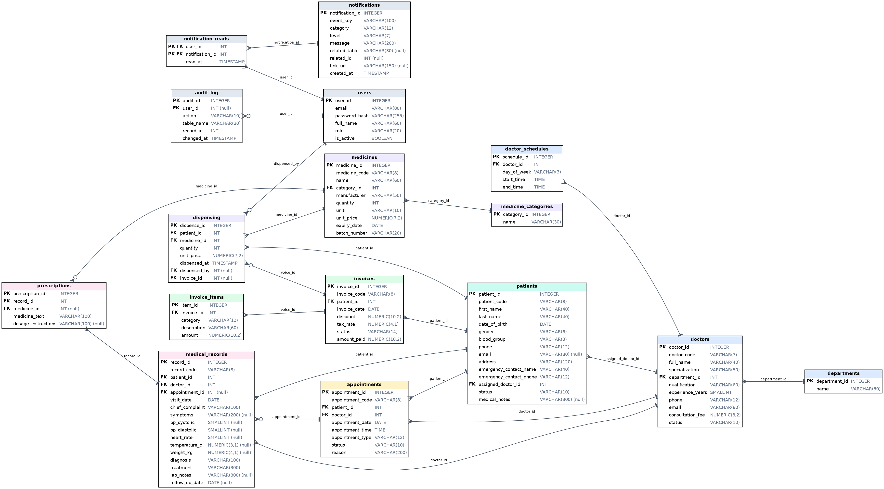

# HMS — Hospital Management System
## Database Design and Verification Report

**Course activity:** Database Design and Validation for the Proposed Product
**Product:** HMS (Patient Management, Doctor Management, Appointments, Medical Records, Billing, Pharmacy)
**Files in this package:** `schema.sql` · `sample_data.sql` · `verify_schema.py` · `test_results.txt` · `er_diagram.png` / `.svg` / `.dot` · this report

---

## 0. Scope and assumptions (read first)

1. **Source of requirements.** The SRS document was not available while preparing this design. The functional requirements (FR-01 to FR-37) in section 6 were **derived from the working HMS frontend prototype** (its six modules, forms, validation rules and unique features). If your SRS uses different requirement IDs, replace the FR IDs in the matrix with your SRS IDs. The tables, columns and constraints do not change.
2. **SQL dialect.** The schema is written in PostgreSQL-style ANSI SQL. It was **built and tested in SQLite**, with one mechanical change (identity column syntax). Patterns use `LIKE`, which works in both systems, instead of PostgreSQL-only regular expressions.
3. **Surrogate keys + business codes.** Every table has an integer primary key. The codes used in the UI (`PAT-0001`, `DOC-001`, `APT-0001`, `REC-0001`, `INV-0001`, `MED-0001`) are kept as `UNIQUE` alternate keys, so the prototype and the database use the same identifiers.
4. Rules that need data from other rows, other tables, or today's date cannot be written as a `CHECK`. They are listed in section 5.3 and are **implemented in the Python server (`server.py`) and tested** (section 7.6).
5. **The web app is connected to this database** (section 9): browser → `server.py` → `HMS_DB/hms.db`. The notifications table has two extra columns (`event_key`, `link_url`) that were added while connecting the app (section 3.14).

---

## 1. Database overview

16 tables in 6 groups, with 20 foreign-key relationships.

| Group | Tables |
|---|---|
| Security and system | `users`, `notifications`, `notification_reads`, `audit_log` |
| Doctor management | `departments`, `doctors`, `doctor_schedules` |
| Patient management | `patients` |
| Appointments | `appointments` |
| Medical records | `medical_records`, `prescriptions` |
| Billing | `invoices`, `invoice_items` |
| Pharmacy | `medicine_categories`, `medicines`, `dispensing` |

## 2. ER diagram



*Notation: crow's foot at the "many" end, bar at the "one" end, a small circle means the relationship is optional (nullable foreign key). `PK` = primary key, `FK` = foreign key, `(null)` = column allows NULL. The diagram is generated from `schema.sql` by `make_er.py`, so it always matches the SQL. A vector version is in `er_diagram.svg`.*

### 2.1 Relationships

| # | Parent (one) | Child (many) | FK column | Optional? | On delete | Meaning |
|---|---|---|---|---|---|---|
| 1 | departments | doctors | department_id | No | RESTRICT | A doctor belongs to one department |
| 2 | doctors | doctor_schedules | doctor_id | No | CASCADE | A doctor works on several days |
| 3 | doctors | patients | assigned_doctor_id | No | RESTRICT | A patient has one assigned doctor |
| 4 | patients | appointments | patient_id | No | RESTRICT | A patient has many appointments |
| 5 | doctors | appointments | doctor_id | No | RESTRICT | A doctor has many appointments |
| 6 | patients | medical_records | patient_id | No | RESTRICT | A patient has many records |
| 7 | doctors | medical_records | doctor_id | No | RESTRICT | A doctor writes many records |
| 8 | appointments | medical_records | appointment_id | **Yes** | SET NULL | A record may come from an appointment |
| 9 | medical_records | prescriptions | record_id | No | CASCADE | A record has 0..n prescription lines |
| 10 | medicines | prescriptions | medicine_id | **Yes** | SET NULL | A prescription line may point to a stocked medicine |
| 11 | patients | invoices | patient_id | No | RESTRICT | A patient has many invoices |
| 12 | invoices | invoice_items | invoice_id | No | CASCADE | An invoice has 1..15 items |
| 13 | medicine_categories | medicines | category_id | No | RESTRICT | A medicine has one category |
| 14 | patients | dispensing | patient_id | No | RESTRICT | A patient receives many dispensed medicines |
| 15 | medicines | dispensing | medicine_id | No | RESTRICT | A medicine is dispensed many times |
| 16 | users | dispensing | dispensed_by | **Yes** | SET NULL | Which user dispensed it |
| 17 | invoices | dispensing | invoice_id | **Yes** | SET NULL | Dispensing may be billed on an invoice |
| 18 | users | notification_reads | user_id | No | CASCADE | Read state is per user |
| 19 | notifications | notification_reads | notification_id | No | CASCADE | (user, notification) is a many-to-many link table |
| 20 | users | audit_log | user_id | **Yes** | SET NULL | Who made a change |

Patients and doctors are in a **many-to-many** relationship through `appointments`, and users and notifications through `notification_reads`.

---

## 3. Table definitions (data dictionary)

Legend: **PK** primary key · **FK** foreign key · **U** unique · **NN** not null · types are PostgreSQL-style.

### 3.1 `users`
| Column | Type | Keys | Constraints |
|---|---|---|---|
| user_id | INT identity | PK | |
| email | VARCHAR(80) | U | NN, valid email pattern |
| password_hash | VARCHAR(255) | | NN (never a plain password) |
| full_name | VARCHAR(60) | | NN |
| role | VARCHAR(20) | | NN, one of Admin / Doctor / Receptionist / Pharmacist / Accountant |
| is_active | BOOLEAN | | NN, default TRUE |

### 3.2 `departments`
| Column | Type | Keys | Constraints |
|---|---|---|---|
| department_id | INT identity | PK | |
| name | VARCHAR(50) | U | NN |

### 3.3 `doctors`
| Column | Type | Keys | Constraints |
|---|---|---|---|
| doctor_id | INT identity | PK | |
| doctor_code | VARCHAR(7) | U | NN, format `DOC-000` |
| full_name | VARCHAR(40) | | NN, at least 2 characters |
| specialization | VARCHAR(50) | | NN, at least 3 characters |
| department_id | INT | FK → departments | NN, RESTRICT |
| qualification | VARCHAR(60) | | NN, at least 2 characters |
| experience_years | SMALLINT | | NN, 0 to 60 |
| phone | VARCHAR(12) | | NN, format `03XX-XXXXXXX` |
| email | VARCHAR(80) | U | NN, valid email pattern |
| consultation_fee | NUMERIC(8,2) | | NN, 0 to 100,000 |
| status | VARCHAR(10) | | NN, default Active, one of Active / On Leave / Inactive |

### 3.4 `doctor_schedules`
| Column | Type | Keys | Constraints |
|---|---|---|---|
| schedule_id | INT identity | PK | |
| doctor_id | INT | FK → doctors | NN, CASCADE |
| day_of_week | VARCHAR(3) | | NN, Mon … Sun |
| start_time | TIME | | NN |
| end_time | TIME | | NN, **must be later than start_time** |
| | | U (doctor_id, day_of_week) | One row per doctor per day |

### 3.5 `patients`
| Column | Type | Keys | Constraints |
|---|---|---|---|
| patient_id | INT identity | PK | |
| patient_code | VARCHAR(8) | U | NN, format `PAT-0000` |
| first_name, last_name | VARCHAR(40) | | NN, at least 2 characters |
| date_of_birth | DATE | | NN (not future, age ≤ 120: rule R1) |
| gender | VARCHAR(6) | | NN, Male / Female / Other |
| blood_group | VARCHAR(3) | | NN, A+ A- B+ B- AB+ AB- O+ O- |
| phone | VARCHAR(12) | | NN, format `03XX-XXXXXXX` |
| email | VARCHAR(80) | | **NULL allowed**; if present, valid email pattern |
| address | VARCHAR(120) | | NN, at least 5 characters |
| emergency_contact_name | VARCHAR(40) | | NN, at least 2 characters |
| emergency_contact_phone | VARCHAR(12) | | NN, format `03XX-XXXXXXX` |
| assigned_doctor_id | INT | FK → doctors | NN, RESTRICT |
| status | VARCHAR(10) | | NN, default Active, Active / Admitted / Discharged |
| medical_notes | VARCHAR(300) | | NULL allowed |

### 3.6 `appointments`
| Column | Type | Keys | Constraints |
|---|---|---|---|
| appointment_id | INT identity | PK | |
| appointment_code | VARCHAR(8) | U | NN, format `APT-0000` |
| patient_id | INT | FK → patients | NN, RESTRICT |
| doctor_id | INT | FK → doctors | NN, RESTRICT |
| appointment_date | DATE | | NN (not in the past, doctor works that day: rule R2) |
| appointment_time | TIME | | NN (30-minute slot inside working hours: rule R2) |
| appointment_type | VARCHAR(12) | | NN, Consultation / Follow-up / Emergency / Check-up |
| status | VARCHAR(10) | | NN, default Scheduled, Scheduled / Confirmed / Completed / Cancelled / Pending |
| reason | VARCHAR(200) | | NN, at least 5 characters |
| | | **U partial index** (doctor_id, appointment_date, appointment_time) `WHERE status <> 'Cancelled'` | **Conflict detection**: no double-booking |

### 3.7 `medicine_categories`
| Column | Type | Keys | Constraints |
|---|---|---|---|
| category_id | INT identity | PK | |
| name | VARCHAR(30) | U | NN |

### 3.8 `medicines`
| Column | Type | Keys | Constraints |
|---|---|---|---|
| medicine_id | INT identity | PK | |
| medicine_code | VARCHAR(8) | U | NN, format `MED-0000` |
| name | VARCHAR(60) | | NN, at least 2 characters |
| category_id | INT | FK → medicine_categories | NN, RESTRICT |
| manufacturer | VARCHAR(50) | | NN, at least 2 characters |
| quantity | INT | | NN, **0 to 100,000** (stock can never go negative) |
| unit | VARCHAR(10) | | NN, Tablets / Capsules / Bottles / Tubes / Vials / Sachets |
| unit_price | NUMERIC(7,2) | | NN, 0.01 to 10,000 |
| expiry_date | DATE | | NN (new medicine must be after today: rule R7) |
| batch_number | VARCHAR(20) | U | NN, at least 3 characters |

### 3.9 `medical_records`
| Column | Type | Keys | Constraints |
|---|---|---|---|
| record_id | INT identity | PK | |
| record_code | VARCHAR(8) | U | NN, format `REC-0000` |
| patient_id | INT | FK → patients | NN, RESTRICT |
| doctor_id | INT | FK → doctors | NN, RESTRICT |
| appointment_id | INT | FK → appointments | NULL allowed, SET NULL |
| visit_date | DATE | | NN (not future, not before date of birth: rule R3) |
| chief_complaint | VARCHAR(100) | | NN, at least 3 characters |
| symptoms | VARCHAR(200) | | NULL allowed |
| bp_systolic / bp_diastolic | SMALLINT | | NULL allowed; ranges 70–250 and 40–150; **both or neither; systolic > diastolic** |
| heart_rate | SMALLINT | | NULL allowed, 30 to 220 |
| temperature_c | NUMERIC(3,1) | | NULL allowed, 30.0 to 45.0 |
| weight_kg | NUMERIC(4,1) | | NULL allowed, 1 to 300 |
| diagnosis | VARCHAR(100) | | NN, at least 3 characters |
| treatment | VARCHAR(300) | | NN, at least 3 characters |
| lab_notes | VARCHAR(300) | | NULL allowed |
| follow_up_date | DATE | | NULL allowed; **if present, not before visit_date** |

### 3.10 `prescriptions`
| Column | Type | Keys | Constraints |
|---|---|---|---|
| prescription_id | INT identity | PK | |
| record_id | INT | FK → medical_records | NN, CASCADE |
| medicine_id | INT | FK → medicines | NULL allowed (free-text prescription), SET NULL |
| medicine_text | VARCHAR(100) | | NN (what the doctor wrote) |
| dosage_instructions | VARCHAR(100) | | NULL allowed |

### 3.11 `invoices`
| Column | Type | Keys | Constraints |
|---|---|---|---|
| invoice_id | INT identity | PK | |
| invoice_code | VARCHAR(8) | U | NN, format `INV-0000` |
| patient_id | INT | FK → patients | NN, RESTRICT |
| invoice_date | DATE | | NN (not in the future: rule R4) |
| discount | NUMERIC(10,2) | | NN, default 0, ≥ 0 (≤ subtotal: rule R5) |
| tax_rate | NUMERIC(4,1) | | NN, default 5, 0 to 30 |
| status | VARCHAR(14) | | NN, default Pending, Paid / Pending / Partially Paid / Cancelled |
| amount_paid | NUMERIC(10,2) | | NN, default 0, ≥ 0; **Partially Paid requires amount_paid > 0** |

### 3.12 `invoice_items`
| Column | Type | Keys | Constraints |
|---|---|---|---|
| item_id | INT identity | PK | |
| invoice_id | INT | FK → invoices | NN, CASCADE |
| category | VARCHAR(12) | | NN, Consultation / Laboratory / Pharmacy / Other |
| description | VARCHAR(60) | | NN, at least 2 characters |
| amount | NUMERIC(10,2) | | NN, 0.01 to 100,000 |

### 3.13 `dispensing`
| Column | Type | Keys | Constraints |
|---|---|---|---|
| dispense_id | INT identity | PK | |
| patient_id | INT | FK → patients | NN, RESTRICT |
| medicine_id | INT | FK → medicines | NN, RESTRICT |
| quantity | INT | | NN, ≥ 1 (≤ stock: rule R8) |
| unit_price | NUMERIC(7,2) | | NN, > 0, **price at the time of sale** |
| dispensed_at | TIMESTAMP | | NN, default now |
| dispensed_by | INT | FK → users | NULL allowed, SET NULL |
| invoice_id | INT | FK → invoices | NULL allowed, SET NULL |

### 3.14 `notifications`, `notification_reads`, `audit_log`
| Table | Columns | Keys and constraints |
|---|---|---|
| notifications | notification_id, **event_key**, category, level, message, related_table, related_id, **link_url**, created_at | PK notification_id; **event_key UNIQUE** (stable key of the situation, e.g. `stock-MED-0002-low`); category in (Pharmacy, Billing, Follow-up, Appointments); level in (info, warning, danger); message NN; link_url is the page the alert opens |
| notification_reads | user_id, notification_id, read_at | **Composite PK (user_id, notification_id)**; both FK with CASCADE |
| audit_log | audit_id, user_id, action, table_name, record_id, changed_at | PK audit_id; user_id FK (nullable, SET NULL); action in (INSERT, UPDATE, DELETE, VIEW) |

### 3.15 Views (derived data is computed, not stored)
| View | Computes | Rule |
|---|---|---|
| `v_invoice_totals` | subtotal, amount after discount, tax amount, total | Subtotal − Discount = After discount; + Tax = Total |
| `v_medicine_status` | stock_status | Expired → Out of Stock (0) → Low Stock (≤ 20) → In Stock |
| `v_dispensing_amount` | amount | quantity × unit_price |

### 3.16 Indexes
`ix_patients_name`, `ix_patients_doctor`, `ix_doctors_department`, `ix_appt_patient`, `ix_appt_date`, `ix_records_patient_date`, `ix_records_followup`, `ix_invoices_patient`, `ix_invoices_status`, `ix_items_invoice`, `ix_medicines_expiry`, `ix_dispensing_patient`, plus `uq_doctor_slot` (the conflict-detection index). They support the searches, filters and timelines used by the screens.

---

## 4. Normalization

### 4.1 From the prototype's data to normalized tables

| Prototype structure | Normal-form problem | Fix in this design |
|---|---|---|
| Doctor `days: ["Mon","Wed","Fri"]` and `time: "09:00-14:00"` | **1NF**: multi-valued attribute and a composite value in one field | `doctor_schedules`: one row per doctor per day with `start_time` and `end_time` |
| Invoice `items: [...]` (a list inside the invoice) | **1NF**: repeating group | `invoice_items`, one row per item |
| Blood pressure stored as the text `"150/95"` | **1NF**: not atomic, cannot be range-checked | `bp_systolic` and `bp_diastolic` |
| Appointment stores `department` and `doctorId` | **3NF**: department depends on the doctor (`doctor_id → department_id`), so it would be a transitive dependency | `department` removed from `appointments`; read through `doctors.department_id` |
| Department name typed as text in doctors and appointments | **Redundancy / update anomaly** | `departments` table |
| Medicine `category` as text repeated on every row | **Redundancy** | `medicine_categories` and FK |
| Invoice total, subtotal, tax amount | **Derived data** | Not stored. Computed in `v_invoice_totals` |
| Medicine `Low Stock / Expired` status; patient `age`; dispensing `amount` | **Derived data** | Not stored. Views (`v_medicine_status`, `v_dispensing_amount`) and age from `date_of_birth` |
| Patient name repeated inside appointments, records, invoices | **Redundancy / update anomaly** | Only `patient_id` is stored; names are read by JOIN |
| Notification "read" ids saved per browser | Cannot work for several users | `notification_reads` (many-to-many) |

### 4.2 Functional dependencies and result

| Table | Candidate keys | Non-key attributes depend on | Highest normal form |
|---|---|---|---|
| users | user_id, email | the whole key | BCNF |
| departments | department_id, name | the whole key | BCNF |
| doctors | doctor_id, doctor_code, email | the whole key | BCNF |
| doctor_schedules | schedule_id, (doctor_id, day_of_week) | the whole key | BCNF |
| patients | patient_id, patient_code | the whole key | BCNF |
| appointments | appointment_id, appointment_code | the whole key | BCNF |
| medicine_categories | category_id, name | the whole key | BCNF |
| medicines | medicine_id, medicine_code, batch_number | the whole key | BCNF |
| medical_records | record_id, record_code | the whole key | BCNF |
| prescriptions | prescription_id | the whole key | BCNF |
| invoices | invoice_id, invoice_code | the whole key | BCNF |
| invoice_items | item_id | the whole key | BCNF |
| dispensing | dispense_id | the whole key | BCNF |
| notifications | notification_id | the whole key | BCNF |
| notification_reads | (user_id, notification_id) | the whole composite key (`read_at`) | BCNF |
| audit_log | audit_id | the whole key | BCNF |

**Reasoning.**
- **1NF:** every column holds one atomic value and there are no repeating groups (section 4.1).
- **2NF:** the only composite key is `notification_reads`, whose single non-key column `read_at` depends on both parts. Elsewhere, each key is a single column, so partial dependencies cannot exist.
- **3NF / BCNF:** in every table, each non-key column depends on the key and nothing else. Wherever a column could be derived from another table (department of an appointment, patient name, invoice total) it was removed.
- **Controlled redundancy (intentional):** `dispensing.unit_price` copies the medicine price at the time of sale. It is not a transitive dependency, because it is a historical fact: if the medicine price changes later, past sales must not change. `medical_records.doctor_id` and `appointments.doctor_id` can differ (a different doctor may write the record), so they are independent facts.
- **Not modelled as separate tables:** fixed value lists (gender, blood group, statuses, appointment types, units) use `CHECK` lists, since they are tiny and stable. Categories and departments are tables because users can add to them.

---

## 5. Integrity validation

### 5.1 Integrity types and where each is enforced

| Integrity type | Mechanism | Examples |
|---|---|---|
| **Entity integrity** | PK on every table, NOT NULL, UNIQUE | `patient_code`, `doctor.email`, `medicines.batch_number`, composite PK in `notification_reads` |
| **Domain integrity** | Data types, CHECK ranges, CHECK lists, formats | experience 0–60, temperature 30–45, tax 0–30, phone format, status lists |
| **Referential integrity** | 20 foreign keys with explicit delete rules | An appointment cannot refer to a missing patient |
| **Business-rule integrity (declarative)** | Multi-column CHECK and a partial unique index | systolic > diastolic; both BP values or none; end time > start time; follow-up ≥ visit date; Partially Paid ⇒ amount_paid > 0; **one active appointment per doctor, date and time** |
| **Business-rule integrity (procedural)** | Triggers or transactions (section 5.3) | dates relative to today, discount ≤ subtotal, stock reduction while dispensing |

### 5.2 Delete rules and why

| Rule | Used for | Reason |
|---|---|---|
| **RESTRICT** | Patient, doctor, department, medicine and category used elsewhere | Clinical and financial history must not disappear. A doctor who leaves is set to *Inactive* instead of deleted |
| **CASCADE** | doctor_schedules, invoice_items, prescriptions, notification_reads | Child rows have no meaning without the parent |
| **SET NULL** | Optional links: record → appointment, prescription → medicine, dispensing → user / invoice, audit_log → user | The child fact must survive when the optional link goes |

### 5.3 Rules that need a trigger or application logic

| ID | Rule | Why a CHECK is not enough |
|---|---|---|
| R1 | Date of birth ≤ today and age ≤ 120 | Depends on today's date |
| R2 | Appointment date ≥ today; doctor is Active, works that weekday, time is a 30-minute slot inside `doctor_schedules` | Depends on today and on another table |
| R3 | Visit date ≤ today and ≥ patient's date of birth | Today and another table |
| R4 | Invoice date ≤ today | Today |
| R5 | Discount ≤ sum of item amounts; amount paid < invoice total when Partially Paid | Needs the child rows |
| R6 | 1 to 15 items per invoice | Counts child rows |
| R7 | Expiry date after today for a new medicine | Today |
| R8 | Dispensing: quantity ≤ stock, medicine not expired, insert dispensing row **and** reduce `medicines.quantity` in one transaction | Multi-table update. The `quantity >= 0` CHECK is the last safety net |
| R9 | Invoices and medical records are never deleted (cancel / audit instead) | A permissions rule in a deployed system |

**Status:** R1 to R8 are enforced by `server.py` (HTTP 400 when broken) and tested; R6 (1 to 15 items) is also enforced there. R9 is enforced in the app by having no Delete button for invoices and records, and by `audit_log`; database-level permissions would be the production version.

*Dates are not put in `CHECK` constraints on purpose: a rule that changes as time passes would make old, valid rows fail when updated.*

---

## 6. Requirements traceability matrix

Functional requirements are derived from the prototype (see section 0). Each row shows which tables, attributes, relationships and constraints make the requirement possible.

| FR | Requirement | Tables | Key attributes | Relationships | Constraints / rules |
|---|---|---|---|---|---|
| FR-01 | The user signs in with email and password | users | email, password_hash, is_active | none | UNIQUE email; email pattern; hashed password |
| FR-02 | Access depends on the user's role | users | role | none | CHECK role list |
| FR-03 | Register a patient with a unique ID and complete details | patients | patient_code, names, date_of_birth, gender, blood_group, phone, address, emergency_contact_* | patients → doctors | UNIQUE patient_code; formats; CHECK lists; R1 |
| FR-04 | Store optional patient email and notes | patients | email, medical_notes | none | NULL allowed; pattern if present |
| FR-05 | Search, filter and sort patients | patients | patient_code, last_name, first_name, phone, email, status, gender | none | ix_patients_name |
| FR-06 | Edit patient details | patients | all columns; patient_code is immutable | none | same constraints on UPDATE |
| FR-07 | Remove a patient safely | patients + dependents | patient_id | appointments, records, invoices, dispensing → patients | ON DELETE RESTRICT |
| FR-08 | Assign a doctor to a patient | patients, doctors | assigned_doctor_id | patients → doctors | FK NOT NULL, RESTRICT |
| FR-09 | View a patient's profile (appointments, records, billing, medicines) | patients, appointments, medical_records, prescriptions, invoices, invoice_items, dispensing | patient_id in each child | patients 1→n each child | FK + indexes ix_appt_patient, ix_records_patient_date, ix_invoices_patient |
| FR-10 | Maintain doctor records with a unique ID and email | doctors | doctor_code, full_name, specialization, qualification, experience_years, phone, email, consultation_fee, status | doctors → departments | UNIQUE doctor_code and email; ranges 0–60 and 0–100,000 |
| FR-11 | Group doctors by department | departments, doctors | department_id, name | departments 1→n doctors | UNIQUE name; RESTRICT |
| FR-12 | Record a doctor's working days and hours | doctor_schedules | doctor_id, day_of_week, start_time, end_time | doctors 1→n doctor_schedules | UNIQUE (doctor, day); end > start |
| FR-13 | Filter doctors by department and availability | doctors, doctor_schedules, departments | department_id, status, day_of_week | as above | ix_doctors_department |
| FR-14 | Doctors can be On Leave or Inactive instead of deleted | doctors | status | doctors referenced by patients and appointments | CHECK status; RESTRICT |
| FR-15 | Book an appointment: department → doctor → date → time | appointments, doctors, doctor_schedules, patients | patient_id, doctor_id, appointment_date, appointment_time, appointment_type, reason | appointments → patients and doctors | CHECK type; reason ≥ 5; R2 |
| FR-16 | Prevent double-booking of a doctor | appointments | doctor_id, appointment_date, appointment_time, status | none | **Partial UNIQUE index uq_doctor_slot** (ignores Cancelled) |
| FR-17 | Reject past dates and non-working days | appointments, doctor_schedules | appointment_date, day_of_week | via doctor_id | R2 (trigger / application) |
| FR-18 | Manage the status workflow (Scheduled, Confirmed, Completed, Cancelled, Pending) | appointments | status | none | CHECK status list; Cancelled frees the slot |
| FR-19 | List and calendar views of appointments by date, status, department | appointments, doctors | appointment_date, status, doctor_id | appointments → doctors → departments | ix_appt_date |
| FR-20 | Record a medical visit with complaint, diagnosis and treatment | medical_records | record_code, visit_date, chief_complaint, diagnosis, treatment | records → patients and doctors | NN fields; length checks; R3 |
| FR-21 | Record optional vital signs with valid ranges | medical_records | bp_systolic, bp_diastolic, heart_rate, temperature_c, weight_kg | none | Ranges; BP both-or-neither; systolic > diastolic |
| FR-22 | Record prescriptions | prescriptions, medicines | record_id, medicine_id, medicine_text, dosage_instructions | prescriptions → records, → medicines (optional) | CASCADE; SET NULL |
| FR-23 | Record lab or test notes and a follow-up date | medical_records | lab_notes, follow_up_date | none | follow_up_date ≥ visit_date |
| FR-24 | Link a record to the appointment it came from | medical_records, appointments | appointment_id | records → appointments (optional) | FK NULL allowed, SET NULL |
| FR-25 | Show a patient's medical history as a timeline | medical_records, prescriptions, appointments, invoices, dispensing | visit_date, appointment_date, invoice_date, dispensed_at | patients 1→n each | ix_records_patient_date |
| FR-26 | Create an invoice with several service items | invoices, invoice_items | invoice_code, patient_id, invoice_date, category, description, amount | invoices 1→n invoice_items; → patients | UNIQUE invoice_code; amount 0.01–100,000; R4, R6 |
| FR-27 | Calculate subtotal, discount, tax and total | invoices, invoice_items | discount, tax_rate, amount | invoice_items → invoices | discount ≥ 0; tax 0–30; **view v_invoice_totals**; R5 |
| FR-28 | Track payment status, including partial payment | invoices | status, amount_paid | none | CHECK status; Partially Paid ⇒ amount_paid > 0; R5 |
| FR-29 | Cancel an invoice instead of deleting it | invoices | status = Cancelled | invoices referenced by items and dispensing | status list; R9 |
| FR-30 | Report charges by category and payment status | invoices, invoice_items | category, status, amount | as above | ix_invoices_status; view |
| FR-31 | Maintain the medicine catalogue with unique ID and batch | medicines, medicine_categories | medicine_code, name, category_id, manufacturer, unit, unit_price, batch_number | medicines → medicine_categories | UNIQUE medicine_code and batch_number; price 0.01–10,000 |
| FR-32 | Track quantity and expiry; show Low / Out of Stock / Expired | medicines | quantity, expiry_date | none | quantity 0–100,000; **view v_medicine_status**; R7 |
| FR-33 | Update stock (add, remove, set exact) without going negative | medicines | quantity | none | CHECK quantity ≥ 0 |
| FR-34 | Dispense medicine: amount calculated, stock reduced, history kept | dispensing, medicines, patients, invoices, users | patient_id, medicine_id, quantity, unit_price, dispensed_at, invoice_id | dispensing → patients, medicines, users, invoices | quantity ≥ 1; unit_price snapshot; **R8 (transaction)** |
| FR-35 | Alerts and notifications with read/unread state per user | notifications, notification_reads, users | category, level, message, related_table, related_id, read_at | many-to-many users ↔ notifications | composite PK; CASCADE |
| FR-36 | Search across patients, doctors, appointments, medical records, medicines, invoices | patients, doctors, appointments, medical_records, invoices, medicines | codes, names, status columns | none | indexes in 3.16 |
| FR-37 | Keep an audit trail of changes | audit_log, users | action, table_name, record_id, changed_at | audit_log → users (optional) | CHECK action list; R9 |

### 6.1 Reverse traceability (every table supports at least one requirement)

| Table | Supports |
|---|---|
| users | FR-01, FR-02, FR-34, FR-35, FR-37 |
| departments | FR-11, FR-13 |
| doctors | FR-08, FR-10, FR-11, FR-13, FR-14, FR-15, FR-19, FR-36 |
| doctor_schedules | FR-12, FR-13, FR-15, FR-17 |
| patients | FR-03 to FR-09, FR-15, FR-34, FR-36 |
| appointments | FR-09, FR-15 to FR-19, FR-24, FR-25, FR-36 |
| medical_records | FR-09, FR-20, FR-21, FR-23, FR-24, FR-25, FR-36 |
| prescriptions | FR-09, FR-22, FR-25 |
| invoices | FR-09, FR-25, FR-26 to FR-30, FR-34, FR-36 |
| invoice_items | FR-09, FR-26, FR-27, FR-30 |
| medicine_categories | FR-31 |
| medicines | FR-22, FR-31, FR-32, FR-33, FR-34, FR-36 |
| dispensing | FR-09, FR-25, FR-34 |
| notifications | FR-35 |
| notification_reads | FR-35 |
| audit_log | FR-37 |

---

## 7. Verification report

### 7.1 Method
1. `schema.sql` and `sample_data.sql` (a copy of the prototype's dummy data) were loaded into a database with foreign-key enforcement on.
2. `verify_schema.py` ran **48 tests**: valid data must be accepted, invalid data must be rejected, and views must give the expected numbers. Results are saved in `test_results.txt`. Re-run with `python3 verify_schema.py`.
3. Completeness was checked by mapping every field of every prototype form to a column (7.3).
4. Traceability was checked in both directions (section 6 and 6.1).

### 7.2 Correctness

| Area | Tests | Result | Examples |
|---|---|---|---|
| Structure | 2 | **2 / 2 pass** | 16 tables created; sample data has no foreign-key violations |
| Entity integrity (E) | 6 | **6 / 6 pass** | Duplicate `patient_code`, doctor email, medicine batch and department name are rejected |
| Domain integrity (D) | 20 | **20 / 20 pass** | Bad phone, gender, blood group, experience 70, fee 200,000, quantity −1, tax 50, temperature 50 rejected; optional email and no-vitals record accepted |
| Business rules (C) | 3 | **3 / 3 pass** | Double booking rejected; another doctor at the same time accepted; a cancelled appointment frees the slot |
| Referential integrity (F) | 7 | **7 / 7 pass** | Missing patient rejected; deleting a doctor, patient or department that is in use rejected; CASCADE and SET NULL behave as designed |
| Derived data (V) | 5 | **5 / 5 pass** | INV-0002: subtotal 135.00, tax 6.25, total 131.25; stock status Low / Out / Expired correct; dispensing 3 × 0.30 = 0.90 |
| Required queries (Q) | 5 | **5 / 5 pass** | Doctor's working days, department → active doctors, patient history, pending-invoice count, unread notifications |
| **Total** | **48** | **48 / 48 pass** | |

**A defect found and fixed during verification.** The first run failed 3 tests: the invoice view computed tax as `tax_rate / 100`, which is integer division in SQLite when the rate is a whole number (5 / 100 = 0), so every invoice total ignored tax. The formula was changed to divide by `100.0`, and all 48 tests then passed. This shows why the numeric views were tested against hand-calculated values. The prototype's calculations (JavaScript) and the view now give the same results for the dummy invoices.

### 7.3 Completeness: every prototype form field has a home

| Prototype form | Fields | Stored in | Notes |
|---|---|---|---|
| Patient | 14 of 14 | `patients` | `age` is derived from `date_of_birth`, not stored |
| Doctor | 13 of 13 | `doctors` + `doctor_schedules` | Available days and the From/Until times become schedule rows |
| Appointment | 8 of 8 | `appointments` | `department` is derived through the doctor (3NF) |
| Medical record | 15 of 15 | `medical_records` + `prescriptions` | Blood pressure split into two numbers; prescription becomes a child table |
| Invoice | all | `invoices` + `invoice_items` | Subtotal, tax amount and total are derived (view) |
| Medicine | 9 of 9 | `medicines` + `medicine_categories` | Stock status is derived (view) |
| Stock update | all | `medicines.quantity` | Result must stay 0 to 100,000 |
| Dispensing | all | `dispensing` | Amount is derived; stock reduced in the same transaction |
| Login | all | `users` | Password stored as a hash |
| Notifications (read / unread) | all | `notifications`, `notification_reads` | |

**Gaps and decisions (stated openly)**
- **Hospital beds** ("Available Beds" on the dashboard) and **Recent Activities** are fixed sample content in the prototype. Beds are **not modelled**. If your SRS requires bed management, add `wards` and `beds` tables. Recent Activities can be read from `audit_log`.
- The prototype allows one time range for all of a doctor's days. The database is more general (a time range per day), so the form can keep its simple version.
- Prescriptions are free text in the prototype. The database supports free text **and** an optional link to a stocked medicine.
- Staff, billing payments by instalment (a `payments` table), and insurance are **not** in the prototype, so they are not modelled. A `payments` table is the natural extension if the SRS requires payment history.

### 7.4 Traceability
- **Forward:** 37 of 37 requirements map to at least one table, with attributes, relationships and constraints named (section 6).
- **Reverse:** 16 of 16 tables support at least one requirement (section 6.1). No table exists without a purpose.
- Each module in the prototype is covered: Patient (FR-03 to FR-09), Doctor (FR-10 to FR-14), Appointments (FR-15 to FR-19), Medical Records (FR-20 to FR-25), Billing (FR-26 to FR-30), Pharmacy (FR-31 to FR-34), cross-cutting (FR-01, 02, 35 to 37).

### 7.5 Limitations
- The SRS was not available (section 0), so requirement IDs and any SRS-only requirements need a final check by you.
- Tests ran in SQLite. PostgreSQL / MySQL differences are limited to the identity column and `LIKE` behaviour. SQLite's `LIKE` ignores case, so `pat-0001` would pass there; PostgreSQL is stricter.
- The code formats use `LIKE 'PAT-____'`, where `_` matches **any** character, so `PAT-ABCD` would also pass. For strict digits-only codes in PostgreSQL, replace the `LIKE` with `~ '^PAT-[0-9]{4}$'` (the same applies to `DOC-`, `APT-`, `REC-`, `INV-`, `MED-` and the phone format). The prototype's JavaScript already enforces digits only.
- Rules R1 to R8 live in `server.py`, not in the SQL; they are tested through the API (section 7.6). R9 is a permissions rule that is not enforced at the database level.
- No performance testing was done. The indexes are chosen from the screens' queries.

### 7.6 Integration verification (web app connected to the database)

| Test suite | Checks | Result | What it proves |
|---|---|---|---|
| `tests/test_api.py` (real server, temporary database, HTTP calls) | 86 | **86 / 86 pass** | Login and sessions; password stored as a hash; data API closed when not logged in; every collection round-trips through the tables; bad phone / gender / blood group, duplicate email or batch, double-booking, negative stock, temperature 50, bad blood pressure all rejected; deleting a doctor, patient or medicine that is in use is blocked by the foreign keys; server rules R1 to R8 return HTTP 400; SQL-injection text is stored as plain data; notifications and per-user read state; logout and reset |
| `tests/e2e_browser_results.txt` (real Chromium driving the real app) | 44 | **44 / 44 pass** | Login; the starting data lands in the tables; all pages load from the database; a patient added through the form appears in `patients`; deleting a patient with appointments is refused with a message; booking, conflict warning, invoice with live total and "Mark as paid", dispensing reduces stock, notification read state survives a reload; audit log is written; reset and logout work; **no JavaScript errors** |
| `selftest.html` (in the browser, through the server) | 58 | **58 / 58 pass** | Data integrity, validation helpers, calculations, page files |

Defects found by these tests and fixed: (1) prescriptions lost their link to the stocked medicine because medical records were written before medicines when seeding (seed order corrected); (2) the "database refused" message fell back to a browser alert instead of the red toast, because `HMSLayout` is a `const` and not a `window` property (fixed); (3) test data with future dates was correctly rejected by the new server rules, and D25 needed `discount = 0` to reach the CHECK it was testing (test inputs corrected).

### 7.7 Conclusion
The design is **correct** (48 of 48 tests pass; integrity is enforced by keys, checks and foreign keys), **complete** with respect to every form and function in the prototype (with the gaps listed above), and **traceable** in both directions. The schema is in BCNF and stores no derived data. It is now **in use**: the web app reads and writes it through `server.py`, and 86 + 44 + 58 integration checks confirm the connection.

---

## 8. How the web app uses this database (implemented)

### 8.1 Architecture
```
browser (HMS/js/storage.js)  --JSON over HTTP-->  server.py  --parameterised SQL-->  HMS_DB/hms.db
```
`storage.js` keeps the interface the page scripts always used (`HMSStore.load / save`) but sends each call to the server. `server.py` turns the JSON "collections" (patients, doctors, …) into rows of the 16 tables, runs everything in one transaction (all or nothing), and returns the database's own refusals as clear messages. All SQL uses parameters, never string concatenation.

### 8.2 How each prototype structure maps to the tables

| Prototype JSON | Database |
|---|---|
| `patients[]` (code `PAT-0001`, `doctorId` = code) | `patients` (surrogate `patient_id`, `patient_code` UNIQUE, `assigned_doctor_id` FK) |
| `doctor.days[]` + `doctor.time` | rows in `doctor_schedules` (one per day) |
| `appointment.department` | not stored; read from `doctors → departments` |
| `medicalRecord.bp = "150/95"` | `bp_systolic`, `bp_diastolic` |
| `medicalRecord.prescription` (text) | `prescriptions` row, linked to `medicines` when the name matches |
| `invoice.items[]` | rows in `invoice_items`; totals from the view `v_invoice_totals` |
| `medicine.category` (text) | `medicine_categories` |
| `pharmacySales[]` | `dispensing` (`DSP-0001` = dispense_id 1; amount computed) |
| read-notification ids | `notifications` + `notification_reads` (per user) |
| login | `users` (PBKDF2 salted hash) |
| every change | `audit_log` |

### 8.3 Where each rule is enforced

| Layer | Rules | Answer when broken |
|---|---|---|
| Browser (`validation.js` and page scripts) | Friendly field messages | Message under the field |
| Server (`server.py`) | R1 to R8, 1–15 items, existence of referenced records, login/session | HTTP 400 / 401 |
| Database (`schema.sql`) | PK, UNIQUE, NOT NULL, CHECK, foreign keys, unique index `uq_doctor_slot` | HTTP 409 |

### 8.4 Known simplifications
- `storage.js` uses synchronous requests (instant on localhost) so the existing page code did not need rewriting; a production client would use `async/await`.
- Each save sends the whole collection and the server works out the differences (insert / update / delete). A production API would have one endpoint per record.
- Roles are stored in `users.role` but not yet enforced per endpoint.
